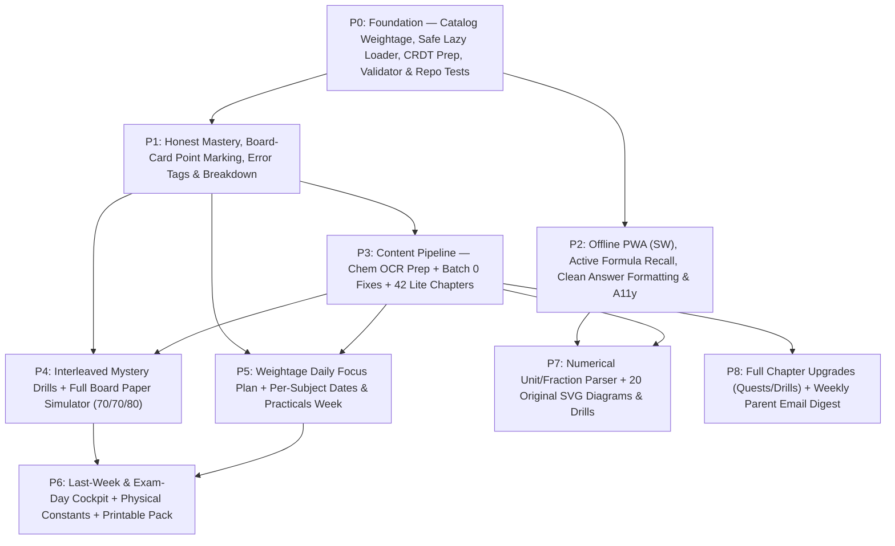

# Master Implementation Plan: Maharashtra HSC Feb 2027 Board Prep Portal

> **Status:** Reviewed & hardened via adversarial Pro-tier architectural, pedagogical, and Flash-executability audit against the live codebase (`assets/app.js`, `assets/sync.js`, `sync/apps-script.gs`, `content/catalog.json`, all 5 live chapter JSONs, and source PDFs).
>
> **Goal:** Evolve the portal from a 5-chapter study aid into a complete, evidence-backed **Maharashtra HSC Std XII Science (Physics, Chemistry, Maths I & II)** board-exam preparation system that genuinely raises marks, reduces exam-hall anxiety, works offline on a phone, and stays simple to use every day.
>
> **Built for Flash-tier execution:** Every phase is self-contained, strictly backward-compatible with `hscPrep.v2`, and specifies exact file paths, schemas, CRDT merge rules, DOM hooks, invariants, and automated unit + headless-Chrome tests so any Flash agent can execute one phase cleanly without guessing or breaking existing student data.

---

## 1. Research Foundation & Student-Perspective Design

Every feature maps verified cognitive-science evidence directly to how a 17-year-old Maharashtra HSC Science student studies and where they gain or lose marks in a 3-hour board exam.

| Research Finding | Evidence | Student Problem Today | How This Plan Solves It |
|---|---|---|---|
| **Practice Testing (Retrieval Practice)** | Dunlosky et al. (2013) *High Utility*; Roediger & Karpicke (2006): active recall yields **61%** 1-week retention vs **40%** for rereading. | Students skim formula sheets passively and tap "Got it" without writing. | **Examiner-point self-marking** on every board card; **Active Formula Recall** (hides `.ff`, keeps name + symbol clue `.fs`); written attempts carry 50% weight in mastery. |
| **Distributed (Spaced) Practice** | Dunlosky et al. (2013) *High Utility*; spreading reviews across weeks beats cramming. | Earlier 2-review schedule retired items in 3 days; Dec learning faded by Feb. | `1→3→7→14→30d` ladder (done) + per-subject exam-eve cap + **graduated-item resurfacing** in the last 10 days before each subject's exam. |
| **Hypercorrection + Error Return** | Butterfield & Metcalfe (2001); Carpenter et al. (2018): confident mistakes hypercorrect strongly after feedback, *but* can return after a week if not re-tested. | Confident mistakes need guaranteed verification across a week-long gap. | Keep confident-mistake priority AND ensure `confident mistake` items are verified after a `>= 7 day` gap before retirement. |
| **Interleaved Practice (huge in Maths/Physics)** | Rohrer & Taylor (2007): **+43% accuracy** on delayed math tests; Rohrer, Dedrick & Stershic (2015): **Cohen's d = 0.79**. | Chapter-by-chapter study hides the hardest exam skill: *choosing which method/formula applies* without a chapter header. | **Mixed-Chapter "Mystery" Drill** (15 min, 6 questions across live chapters of a subject; chapter tag hidden until revealed). |
| **Rubric-Based Self-Assessment** | Panadero & Jonsson (2013); Panadero, Jonsson & Botella (2017, N=2,305): improves self-regulation (**d = 0.23–0.65**) and self-efficacy (**d = 0.73**). | Tapping "Need practice" hides *why* marks were lost. | **1-tap Error Tag** (`Concept`, `Calculation`, `Units / Conditions`, `Diagram`, `Steps`, `Time`) on every `< full marks` answer + Error Breakdown for student & parent. |
| **The Drawing Effect** | Wammes, Meade & Fernandes (2016): drawing beats writing/rereading (**Cohen's d = 1.30**, 43/49 students). | Sections C & D award dedicated diagram marks; Maths circuits are bracketed text. | Original lightweight **SVGs** + **"Sketch on paper → Reveal & check labels"** drill + explicit 1-mark diagram rubric point. |
| **Transfer-Appropriate Processing** | Morris et al. (1977): performance transfers best when practice matches real test conditions. | Chapter rounds lack Sections A–D, internal choice ("any 8 of 12"), 15-min reading time, and no-calculator log-table discipline. | **Full Board Paper Simulator** matching official MSBSHSE patterns (Phy/Chem 70m, Maths I+II 80m) with 15-min reading/choice phase, 3-hr clock, log-table reminder, and printable paper + answer key. |
| **Anti-Overwhelm & Self-Efficacy** | Seeing "572 stops left — 11 stops/day!" triggers avoidance and burnout in teens. | Home shows an impossible raw stop count, ignoring practicals week and chapter weightage. | **Marks-Weighted "Today's Focus"** (3–4 concrete blocks fitting a realistic 90m weekday / 180m weekend budget + lighter practicals week) with a clear *"Done for today ✓"* finish line. |

### Verified Official Maharashtra HSC Std XII Paper Patterns

| Subject | Theory / Practical | Section A (Compulsory) | Section B (2m) | Section C (3m) | Section D (4m) | Attempted / With Options |
|---|---|---|---|---|---|---|
| **Physics (Code 54)** | 70 / 30 | Q1: 10 MCQ × 1m = 10<br>Q2: 8 VSA × 1m = 8 | Q3–Q14: **8 of 12** = 16 | Q15–Q26: **8 of 12** = 24 | Q27–Q31: **3 of 5** = 12 *(often 2m theory + 2m numerical)* | **70 / 98** (3 hrs · log table only) |
| **Chemistry (Code 55)** | 70 / 30 | Q1: 10 MCQ × 1m = 10<br>Q2: 8 VSA × 1m = 8 | Q3–Q14: **8 of 12** = 16 | Q15–Q26: **8 of 12** = 24 | Q27–Q31: **3 of 5** = 12 *(often composite 2+2 or 2+1+1)* | **70 / 98** (3 hrs · log table only) |
| **Maths & Stats (Code 40 · I+II)** | 80 / 20 | Q1: **8 MCQ × 2m = 16**<br>Q2: 4 VSA × 1m = 4 | Q3–Q14: **8 of 12** = 16 | Q15–Q26: **8 of 12** = 24 | Q27–Q34: **5 of 8** = 20 *(includes theorem proofs)* | **80 / 112** (3 hrs · log table only, no graph paper) |

---

## 2. Global Architecture, Test Harness & Non-Negotiable Invariants

### Repo & Test Harness Layout (Standardized for All Agents)
To ensure ANY Flash agent in ANY session can run tests identically without hunting across scratch folders:
- **In-repo zero-dependency Node scripts** (added in P0, never loaded by browser):
  - `scripts/validate.js` — validates `catalog.json`, all chapter JSONs, SVG assets, ID uniqueness, point sums, and exact weightage totals (`70/98`, `70/98`, `80/112`).
  - `scripts/test_sync.js` — moved/mirrored into repo from scratch; pure Node unit tests for `assets/sync.js` CRDT commutativity, idempotency, tombstones, legacy `hscPrep.v2` compatibility, and 500 KB byte-budget ceiling.
  - `scripts/test_core.js` — pure Node unit tests for pure logic exported from `assets/app.js` via a clean 5-line test hook (`window.__HSC_TEST` in browser / `module.exports` guard when `typeof document === "undefined"`).
  - `scripts/e2e.js` — headless Chrome / Puppeteer runner (reads `PUPPETEER_PATH` or scratch `e2e/node_modules/puppeteer-core`, starts its own ephemeral Node `http` static server on an unused port, tests **390×844** and **820×1180**, exits cleanly). **Never commit `node_modules/`** (add `node_modules/` to `.gitignore`).

### The 10 Invariants (Check Before Every Commit)
1. **Zero build step, zero runtime external libraries.** Plain HTML5, CSS3, ES5-style vanilla JS (`var`, standard DOM APIs).
2. **No polling, no heartbeats, no auto-refresh.** Network sync happens ONLY on page load, `visibilitychange`, `online`, debounced local save, or explicit user/teacher button tap.
3. **Teacher UI stays invisible to students.** Never show `#teacher-pill`, Sync-page Teacher card, or Preview buttons unless `SYNC.hasTeacherConfig()` is true.
4. **Strict `hscPrep.v2` backward compatibility.** Existing `localStorage` and Google Drive JSONs MUST load, render, and sync with zero data loss and zero phantom pushes (`statesEqual(normalizedLegacy, mergedLegacy) === true`).
5. **Legacy Physics Ch 1 compatibility.** `physics/ch01` keeps `st.round` and bank token `"ch01"`, and bare IDs (`2023-Q5`, `d1`, `imp-s06-...`) allowlisted as legacy in `scripts/validate.js`. **All other 46 chapters MUST use their exact `prefix` from Appendix A.**
6. **Sync CRDT determinism & 500 KB payload safety.** Every persisted field added to `blank()` in `assets/app.js` MUST simultaneously be added to `normalizeState()`, `assets/sync.js` (`mergeState` with deterministic tie-breaks + `canonicalForCompare`), and `scripts/test_sync.js`. **NEVER store question text, `ids[]`, or per-question `results[]` inside `roundHist` or `papers[]`.** Max populated 47-chapter state MUST stay `< 250 KB` (well under `MAX_STATE_BYTES = 500000`).
7. **Balbharati Std XII Science English Medium only.** Never commit PDFs, past-paper scans, student data, `/exec` URLs, `STUDENT_CODE`, or `TEACHER_KEY`.
8. **Mobile-first responsive layout.** Every phase passes E2E at **390×844** and **820×1180** with `scrollWidth <= innerWidth` and 0 console/page errors.
9. **Safe `fm()` formatting.** `fm(s)` ALWAYS escapes HTML first and only emits inline tags (`<sub>`, `<sup>`, `<br>` — NEVER `</p><p>` which breaks `<h2>`/`<li>`/`<span>`).
10. **Mandatory Verification Gate before EVERY commit & push to `main`:**
    ```bash
    node --check assets/app.js && node --check assets/sync.js
    node scripts/validate.js
    node scripts/test_sync.js
    node scripts/test_core.js
    node scripts/e2e.js
    find . -iname '*.pdf' -not -path './.git/*'                 # must be empty
    rg -l 'AK'+'fycb|script.google.com/macros/s/[A-Za-z0-9_-]{20,}' . # must be empty
    ```

---

## 3. Master Phase Roadmap



| Phase | Scope | Student Payoff | Effort | Dependencies |
|---|---|---|---|---|
| **P0** | Foundation: 47-ch catalog weightage, safe lazy loader, CRDT fields, validator, in-repo test suite | Fast phone loads even at 47 chapters; rock-solid sync & data safety | M | None |
| **P1** | Honest mastery (20/50/30), board-card point marking, 1-tap error tags & breakdown | Honest score `/70, /70, /80`; student & parent pinpoint exact mark leaks | M | P0 |
| **P2** | Offline PWA (`sw.js`), Active Formula Recall, `<br>` formatting, board tips, arrow-key a11y | Opens offline on exam morning; formulas become flashcards; readable answers | S | P0 |
| **P3** | Chem 2024/25 scan transcription + Batch 0 fixes + 42 Lite chapters (5 parallel batches) | **100% syllabus coverage (47/47 chapters)** with PYQs, summaries & formulas | L (batched) | P0, P1 |
| **P4** | Interleaved "Mystery" Drills + Full Board Paper Simulator (Sections A–D, choice, print) | Builds 3-hr stamina, 8-of-12 choice strategy, and blind method selection | L | P1 (best after P3 B1+) |
| **P5** | Marks-weighted "Today's Focus" plan, per-subject dates, practicals week, teacher boost | Replaces scary "11 stops/day" with calm, highest-marks-per-hour daily plan | M | P1, P3 |
| **P6** | Last-Week & Exam-Day Mode, resurfaced graduated mistakes, Physical Constants & Log-table rules | One calm cockpit + printable packet for the final 10 days before each paper | M | P4, P5 |
| **P7** | `num` unit picker + fraction/`π`/superscript `parseNum` + 20 hand-authored SVGs & diagram drill | Saves 5–10 marks on SI units, exact fractions, and labelled diagrams | M | P2, P3 |
| **P8** | Upgrade top-weightage Lite chapters to full Quests/Drills + Weekly Parent Email Digest | Deep interactive quests on 6–12 mark chapters + passive Sunday parent email | L (ongoing) | P3 |

---

## 4. Detailed Phase Specifications (Flash-Agent Ready)

---

### Phase P0: Foundation — Catalog Metadata, Safe Lazy Loader, CRDT Prep, Validator & Tests

#### Student Benefit
Keeps phone cold load fast (**1–3 small JSONs** instead of 47 HTTP requests / 3 MB) once all 47 chapters are live, keeps scroll position steady on sync, reduces unnecessary Drive sync writes, and builds the automated safety net for every later phase.

#### Files Touched
- **Create:** `.gitignore` (`node_modules/`), `scripts/validate.js`, `scripts/test_sync.js`, `scripts/test_core.js`, `scripts/e2e.js`
- **Modify:** `content/catalog.json`, `assets/app.js`, `assets/sync.js`

#### Exact Specifications

1. **`content/catalog.json` Schema Upgrade:**
   - Top-level additions:
     ```json
     "exams": { "physics": "2027-02-15", "chemistry": "2027-02-20", "maths": "2027-02-25" },
     "examsTentative": true,
     "practicalsStart": "2027-01-25",
     "dailyMinutes": { "weekday": 90, "weekend": 180 },
     "paperGroups": {
       "physics": { "title": "Physics", "paperMarks": 70, "withOptions": 98, "subjects": ["physics"] },
       "chemistry": { "title": "Chemistry", "paperMarks": 70, "withOptions": 98, "subjects": ["chemistry"] },
       "maths": { "title": "Maths & Statistics (I + II)", "paperMarks": 80, "withOptions": 112, "subjects": ["maths1", "maths2"] }
     }
     ```
   - Every chapter entry (all 47) gets exact `marks`, `marksWithOptions`, `prefix` from **Appendix A**, plus for live chapters (`file` present): `stopCount` (exact `stops.length`), `boardCount` (exact `board.length`), and `lite` (`false` for the 5 existing chapters).

2. **Safe Lazy Chapter Loader (`assets/app.js`) — Fixes All 18 Synchronous Consumers:**
   - **Never conflate "live chapter" with "loaded JSON"!** Maintain TWO structures:
     - `LIVE_MAP` & `LIVE_LIST`: built synchronously from `catalog.subjects` for every entry with `c.file` (holds `{ key, subj, subjTitle, chId, meta }` where `meta` has `title, number, file, marks, marksWithOptions, stopCount, boardCount, lite, prefix`).
     - `CHAPTERS`: cache of actually fetched JSONs (`key -> chJSON`). `CHAPTER_LIST` becomes a helper/getter over loaded chapters ONLY where JSON internals are required; **all catalog-level views iterate `LIVE_LIST`!**
   - **Async deduped loader:**
     - `ensureChapter(subj, chId)` / `ensureChapters(keys)` (returns `Promise`, caches in-flight promises in `LOADING[key]`).
     - `ensureSubjectChapters(paperKey)` and `ensureAllChapters()`.
     - **Generation-guarded router (`var routeGen = 0;`):** increment `myGen = ++routeGen` on every `route()`. Before rendering after an `await`/`.then()`, check `if (myGen !== routeGen) return;` so fast taps never render stale views!
   - **Smart Boot (`bootNeededKeys(st, td)`):**
     - Collect ONLY the chapter keys needed to make Home **100% exact without approximations**:
       1. `st.lastChapter` (if valid in `LIVE_MAP`), else `LIVE_LIST[0].key`.
       2. Any live chapter key the student has **started** (appears in `st.done` prefix `subj/chId/`, `st.quest`, `st.qp`, `st.rounds` with activity, `st.round` if non-empty for `physics/ch01`, or `st.boardPts`).
       3. Chapter referenced by `td.focus` or `td.reward.chKey` (if teacher data cached).
       4. The first live chapter where `doneCount(st, key) < meta.stopCount` (for `pickNextStop`).
     - **Unstarted chapters mathematically have mastery `= 0`**, so Home `homeGaugeHTML` and `planInfo` are **100% exact** while fetching only 1 chapter for a new student (and only started chapters for an active student)!
   - **Exact fixes for all remaining consumers:**
     - `activeSubjects()`: check `LIVE_MAP` (NOT `CHAPTERS`!) so `planInfo()` ALWAYS counts all active subjects!
     - `homeView()` chapter list: check `!!c.file` (NOT `!!CHAPTERS[key]`!) so unloaded live chapters NEVER say `"Coming soon"`; show `doneCount(st, key) + " / " + c.stopCount + " stops"` from `catalog` + `st.done`!
     - `updateChrome()` `#due-badge`: `dueIds().filter(function(id){ var k = parseId(id).chKey; return !!LIVE_MAP[k] && (!CHAPTERS[k] || itemExists(id)); }).length` — never undercounts due items from unloaded chapters!
     - `applyTeacherAssignments(td)`: collect keys in `td.assigned`, call `ensureChapters(keys).then(...)` before adding to `st.bank`.
     - Route-level lazy loading before render:
       - `#/<subj>/<ch>/...` → `ensureChapters([key])`
       - `#/formulas` → pills built from `LIVE_LIST`; current chapter fetched via `ensureChapters([fKey])`; `"All chapters"` calls `ensureAllChapters()`
       - `#/notes` → `ensureChapters(keysInNotes(st))`
       - `#/review` → `ensureChapters(keysInBank(st).concat(lastRoundChKey ? [lastRoundChKey] : []))`
       - `#/teacher` → `ensureAllChapters()`
       - `#/paper/*`, `#/mix/*`, `#/revise/*` → `ensureSubjectChapters(paperKey)`
   - **Scroll preservation:** In `applyRemoteState()`, save `var sy = window.scrollY;` before re-render and restore `window.scrollTo(0, sy)` after.
   - **Study timer sync noise fix:** Keep 15 s in-memory tick, write `save()` every **4th tick (60 s)** + flush on `visibilitychange` (hidden) and `pagehide`.

3. **Canonical `kind` Enum & Display Map (`assets/app.js` + `scripts/validate.js`):**
   - Standardize to **10 lowercase keys**: `mcq`, `vsa`, `define`, `distinguish`, `numerical`, `derivation`, `proof`, `theory`, `diagram`, `problem`.
   - Add `KIND_LABEL` display map in `assets/app.js` (`mcq: "MCQ"`, `vsa: "VSA"`, `define: "Definition"`, `distinguish: "Distinguish"`, `numerical: "Numerical"`, `derivation: "Derivation"`, `proof: "Proof"`, `theory: "Theory"`, `diagram: "Diagram"`, `problem: "Problem"`, fallback `esc(q.kind)` for any legacy title-case strings).

4. **New Persisted State Fields & Strict CRDT Merge Rules (`assets/app.js` + `assets/sync.js`):**
   - Add to `blank()` & `normalizeState()` in `assets/app.js`:
     - `roundHist: {}` — map `chKey -> Array<{at, date, mode, got, of, pct, secs?, errs?}>` (**SLIM: NO `ids` or `results`!** Capped at **20** per chapter). `errs` is a compact count map `{ units: 1, calc: 2 }`.
     - `boardPts: {}` — map `qId -> { got, of, at, err }` (`err` string, `""` if none).
     - `graduated: {}` — map `bankId -> timestampMs`.
     - `errLog: []` — capped at **200** entries `{ at, date, id, chKey, err }`.
     - `papers: []` — capped at **30** entries `{ id, at, date, paperKey, mode, full, got, of, pct, secs, secScores, errs }` (**SLIM: NO full question arrays!**).
     - `paperRun: null`, `paperRunDel: 0` — active mock paper run + tombstone.
     - `predSummary: {}` — compact `{ physics, chemistry, maths, at }` updated on Home/round finish so Apps Script weekly email & summary sheet (P8) can read predicted marks without fetching 47 JSONs!
   - **Exact `assets/sync.js` CRDT Merge Rules (ALL must satisfy `merge(A,B) === merge(B,A)` and `merge(A,A) === A`):**
     - `pickBankItem(a, b)`: add deterministic tie-breaker on `String(a.err || "") >= String(b.err || "")`; preserve `err: String(chosen.err || "")` cleanly (never `undefined`).
     - `roundHist[chKey]`: union by `at + "|" + mode + "|" + got + "|" + of`; sort by `b.at - a.at || cmp(a.mode,b.mode) || b.pct - a.pct || b.got - a.got`; slice `0..20`.
     - `boardPts[qId]`: keep larger `at`; tie-break: higher ratio `(of > 0 ? got/of : 0)`, then higher `of`, then `cmp(errA, errB)`.
     - `graduated[id]`: union keys, `Math.max(num(a), num(b))`.
     - `errLog`: filter valid objects (`typeof x.at === "number" && typeof x.id === "string"`); union by `at + "|" + id + "|" + (err || "")`; sort by `b.at - a.at || cmp(a.id,b.id) || cmp(a.err,b.err)`; slice `0..200`.
     - `papers`: union by `id` (keep larger `at`, tie-break `got`, then `canonicalJSON`); sort by `b.at - a.at || cmp(a.id,b.id)`; slice `0..30`.
     - `paperRun` / `paperRunDel`: `delAt = Math.max(num(A.paperRunDel), num(B.paperRunDel))`; keep non-deleted run with larger `at` (tie-break: phase rank `mark>write>read`, then `i`, then `canonicalJSON`); if chosen from remote, set `win.since = 0; win.resumed = true`.
     - `predSummary`: keep whichever has larger `num(at)`.
     - **`canonicalForCompare(st)`:** normalize all 8 new fields (`roundHist:{}`, `boardPts:{}`, `graduated:{}`, `errLog:[]`, `papers:[]`, `paperRun:null` with `resumed` stripped, `paperRunDel:0`, `predSummary:{}`) so legacy Drive files compare equal without phantom pushes!
     - **`applyRemoteState()` in `app.js`:** also check `prevPaperRun !== nextPaperRun` and pause/clear in-memory `PR` cleanly.

5. **Content Validator (`scripts/validate.js`):**
   - Pure Node, exits `0` on pass, `1` on errors. Supports `--strict` (for CI / post-Batch-0).
   - Validates:
     1. Exact weightage sums: Physics `70 / 98`, Chemistry `70 / 98`, Maths I + II `80 / 112`.
     2. For every live chapter: `stopCount === ch.stops.length`, `boardCount === ch.board.length`, valid `book` key, `pdfPageOffset` integer.
     3. Globally unique `board[].id` and `derivations[].id` across ALL chapter files; `id.startsWith(entry.prefix)` enforced on every chapter except allowlisted legacy `physics/ch01`.
     4. Every `board` item: `points` sum === `marks`; `stop` exists; MCQ has `options.length >= 3`; near-duplicate text check within chapter (normalized alphanumeric equality OR Dice bigram similarity `> 0.88`).
     5. `page` & canonical lowercase `kind` on `board` items: **hard error** on all `lite: true` chapters and when `--strict` is passed; **warning** on the 5 pre-existing chapters until P3 Batch 0 completes.
     6. `stops[].quest`: required when `!ch.lite`, optional when `ch.lite === true` (if present, validates `cards`, `checks`, `0 <= answer < options.length`, finite `num` + non-empty `unit`, `page`).
     7. `fig` references (for P7): if present, file must exist on disk, `< 15 KB`, valid SVG, zero `<script` or `http://`/`https://`.

6. **Node Test Hook (`assets/app.js`):**
   - Expose pure functions (`stopMastery`, `gaugeData`, `planInfo`, `parseNum`, `fm`, `nextReviewDate`, `errorSummary`, `buildPaper`, `todayFocusPlan`) on `window.__HSC_TEST` (browser) and guard DOM boot when `typeof document === "undefined"` + export on `module.exports` so `scripts/test_core.js` runs in `< 100 ms` in pure Node!

#### Verification & Tests (P0)
- `scripts/validate.js` exits `0` on current 5 chapters + 47-chapter catalog weightages.
- `scripts/test_sync.js` verifies:
  - Golden pre-P0 legacy `hscPrep.v2` state merges cleanly and `statesEqual(normalizedLegacy, mergedLegacy) === true`.
  - Commutativity & idempotency for ALL 8 new fields + `pickBankItem.err`.
  - Stress test: fully populated 47-chapter max-capped state (`47×20` `roundHist`, `700` `boardPts`, `200` `errLog`, `30` `papers`, `550` `done`) serializes to `< 250 KB` (verified `< 500 KB`).
- `scripts/e2e.js` (390×844 & 820×1180):
  - Fresh cold boot fetches `catalog.json` + **only 1** chapter JSON.
  - Seed `localStorage` with due bank item in unloaded `maths2:ch01` → `#due-badge` shows `1` immediately on boot; opening `#/review` lazy-loads `maths2/ch01` and renders the item.
  - Seed note in unloaded `chemistry/ch01` → `#/notes` loads and displays it.
  - Seed paused quest in unloaded `maths1/ch01` → Home shows `"Continue quest"`.
  - Home shows `"Coming soon"` ONLY for chapters without `file`, never for unloaded live chapters; `planInfo()` counts all 4 active subjects.
  - Direct deep-link `#/maths2/ch01/s03/quest` on cold load renders cleanly.
  - Scroll position preserved on `applyRemoteState`.

---

### Phase P1: Honest Mastery, Board-Card Point Marking, Error Tags & Analytics

#### Student Benefit
Predicted marks stop giving false comfort ("2/3 quiz + blind Got it = 100%") and instead show realistic board readiness out of **70 / 70 / 80**. One-tap error tags reveal *why* marks are leaking (`Units / Conditions`, `Calculation`, `Diagram`, `Steps`, `Concept`, `Time`) to both student and parent.

#### Files Touched
- **Modify:** `assets/app.js`, `assets/app.css`, `scripts/test_core.js`, `scripts/e2e.js`

#### Exact Specifications

1. **Error Tags Constant (`ERR_TAGS` in `assets/app.js`):**
   - 6 concise tags with 1-line student coaching tips:
     - `concept`: "Concept" — *"Re-read the textbook section and In-short summary before retrying."*
     - `calc`: "Calculation" — *"Write intermediate values clearly and double-check powers of 10."*
     - `units`: "Units / Cond." — *"Check SI unit on every final number, or reagent/conditions in Chemistry."*
     - `diagram`: "Diagram" — *"Sketch and label the figure neatly before step 1."*
     - `steps`: "Steps / Format" — *"State formula first, show substitution, box the final result."*
     - `time`: "Time" — *"Practice timed section drills to speed up recall."*

2. **Honest `stopMastery(s, st, ch)` (Zero-`NaN` Safe for Full & Lite Stops):**
   - Weighted components (normalize by sum of present weights; return `0` if `wSum === 0`):
     - **If `s.quest` exists:** Quest weight `0.20` — `1.0` if `(q.best >= s.quest.checks.length)` OR `(isDone && q.plays >= 2)`; `0.65` if `isDone`; else `0`.
     - **If `!s.quest` (Lite stop):** Revised weight `0.15` (if board/drills exist) or `0.50` (if neither board nor drills exist on this stop, so `0/0` NEVER happens!) — `isDone ? 1.0 : 0`.
     - **Board Questions** (if `bq.length > 0`): weight `0.50` (full) or `0.85` (lite without drills) or `0.55` (lite with drills). Per question `q`:
       - Let `bp = st.boardPts[q.id]`, `ba = st.boardAt[q.id] || 0`, `bv = st.board[q.id]`.
       - If `bv === "need"` AND `(!bp || ba > bp.at)` → `0` *(fixes the `"Need practice"` after `3/3` precedence bug!)*.
       - Else if `bp && bp.of > 0` → `Math.min(1, bp.got / bp.of)`.
       - Else if `bv === "got"` → `0.5` *(legacy quick-tap gets half credit until written & point-marked)*.
       - Else → `0`.
     - **Drills** (if `ds.length > 0`): weight `0.30`. Per drill `d`: `dr.clean ? 1.0 : (dr.runs > 0 ? 0.5 : 0)`.
   - **Chapter Recency Blend (`gaugeData`):**
     - `stopM = tw ? sw / tw : 0`.
     - Find completed full rounds in `st.roundHist[chKey]` (or fallback `RS().bestFull`). If any exist: `recentPct = 0.6 * latestFullPct + 0.4 * bestFullPct`; `M = 0.7 * stopM + 0.3 * (recentPct / 100)`.
     - If no full round yet: `M = Math.min(0.85, stopM)` (100% requires actually completing a full board round!).

3. **Full-Paper Predicted Marks on Home (`homeGaugeHTML`):**
   - Uses `catalog.paperGroups` (`physics /70`, `chemistry /70`, `maths /80`).
   - When `homeSubj === "all"`: show all 3 board papers (`Physics: ~X of 70`, `Chemistry: ~Y of 70`, `Maths I+II: ~Z of 80`) with expandable active chapter bars.
   - When filtered to `physics` or `chemistry`: show that paper (`/70`). When filtered to `maths1` or `maths2`: show that part's subtotal (`~X of 40`) plus a pill noting `"Combined Maths paper: ~Z of 80"`.
   - Formula per paper: `sum(chMeta.marks * chapterMastery)` across all chapters in the paper (unstarted chapters = `0`), rounded to nearest `0.5`, clamped to `[0, paperMarks]`.
   - Persist compact `st.predSummary = { physics, chemistry, maths, at: Date.now() }` when values change (silent local save, synced on next normal save).

4. **Examiner-Point Marking Directly on Board Cards (`boardCard` + `bqDraft`):**
   - Maintain in-memory `bqDraft[q.id] = { ticks: [...], err: "" }` so checking points or picking an error tag survives card re-render.
   - Before revealing model answer: show **"Show model answer"** + **"Need practice"** (sets `st.board[q.id] = "need"`, `st.boardAt[q.id] = now`, adds to bank).
   - After revealing model answer:
     - Show model answer + examiner-point checkboxes (`data-act="bq-tick"`) + a convenient **"All correct ✓"** toggle button (`data-act="bq-all"`) so marking a full-score answer takes 1 tap, not 4!
     - When ticked marks `< q.marks`, show the compact 6-pill `"Why lost marks? (optional)"` row (`data-act="bq-err"`).
     - Primary button **"Save score (X / Y marks)"** (`data-act="bq-save"`):
       - Writes `st.boardPts[q.id] = { got: X, of: Y, at: now, err }`, `st.board[q.id] = X >= Y ? "got" : "practice"`, `st.boardAt[q.id] = now`.
       - If `X < Y`: calls `bankAdd(bankId("b", q.id), "below full marks", err)` and if `err` chosen, pushes `{ at: now, date: today(), id: q.id, chKey: curChKey(), err }` to `st.errLog` (capped at 200).
       - Shows saved badge `"Saved: X / Y marks"`.

5. **Board Rounds, Review & Bank Updates:**
   - **`roundRender()` / `roundNext()`:** Add `RD.run.err` (1-tap error pill row whenever ticked marks `< q.marks`). In `roundNext()`, write `st.boardPts[q.id] = { got, of: q.marks, at: now, err }`, pass `err` to `bankAdd()`, and append to `st.errLog` if `err`.
   - **`roundFinish()`:** Fix `CH` bug → use `var ch = CHAPTERS[RD.chKey] || CH;`! Append compact `{ at, date, mode, got, of, pct, secs, errs }` to `st.roundHist[RD.chKey]` (capped at 20).
   - **`reviewRender()` / `rv-score`:** Add `R.err` for point-marked reviews; update `st.boardPts[q.id]` and `st.errLog` on submit.
   - **`bankAdd(id, reason, err)`:** Preserve `old.err` if `err` not passed (`err: err || (old && old.err) || ""`).
   - **`bankReview(id, ok)`:** Record `st.graduated[id] = now` when item completes `REVIEW_GAPS.length` (5 reviews). For `confident mistake`, enforce `gap >= 7` from `streak >= 1` (`1 → 7 → 14 → 30d` verification against hypercorrection relapse!). Use `subjectExamDate(parseId(id).chKey)` instead of hardcoded `catalog.examDate` inside `nextReviewDate()`.

6. **Error Breakdown Card (Home & Teacher View):**
   - `errorSummary(st, 14)` aggregates `st.errLog` in last 14 days.
   - Renders on Home (when `total >= 2`) and in Teacher View per student (when `total >= 1`), showing top 3 leak types with count, share bar, and the 1-line coaching tip.

#### Verification & Tests (P1)
- `scripts/test_core.js`: unit tests covering full stop, lite stop with 0 board/0 drills (must NOT be `NaN`!), `"Need practice"` overriding older `3/3` `boardPts`, chapter 85% cap without full round, `errorSummary` 14-day cutoff, hypercorrection `>= 7d` gap.
- `scripts/e2e.js` (390px & 820px): board card reveal → `"All correct"` toggle → untick 1 point → tap `Units / Cond.` → Save → verify `boardPts`, `bank`, `errLog`; verify Home shows `/70, /70, /80`; complete a 1-mark round → verify `roundHist` appended (and has NO `ids`/`results` bloat!) and Error Breakdown card renders.

---

### Phase P2: Offline PWA, Active Formula Recall, Clean Answer Formatting & A11y

#### Student Benefit
App opens from the phone home screen with **zero internet** (bus, coaching, exam morning). Formula sheets transform into active-recall flashcards (`Knew it / Missed`) while keeping symbol clues visible. Multi-step model answers read cleanly with board presentation tips.

#### Files Touched
- **Create:** `manifest.webmanifest`, `assets/icon-192.svg`, `assets/icon-512.svg`, `sw.js`
- **Modify:** `index.html`, `assets/app.js`, `assets/app.css`, `scripts/test_core.js`, `scripts/e2e.js`

#### Exact Specifications

1. **PWA Manifest & Subpath-Safe Service Worker (`sw.js`):**
   - `manifest.webmanifest`: relative `start_url: "./"`, `scope: "./"`, `display: "standalone"`, clean SVG icons. Linked in `index.html`.
   - `sw.js` (~50 lines, **zero timers/polling**):
     - `var CACHE = "hsc-prep-v1";`
     - `install`: `self.skipWaiting()` + precache `./`, `./index.html`, `./assets/app.css`, `./assets/app.js`, `./assets/sync.js`, `./content/catalog.json`.
     - `activate`: delete old `hsc-prep-*` caches + `self.clients.claim()`.
     - `fetch`:
       - Pass through non-GET and cross-origin requests (`url.origin !== self.location.origin`, so `script.google.com` is NEVER touched!).
       - Navigation requests: match `./index.html` with `{ ignoreSearch: true }` (so `?today=...` and GitHub Pages `/hsc-study-portal/` both hit cache offline!), while updating cache in background.
       - Same-origin static/JSON assets: **stale-while-revalidate**, caching ONLY when `res && res.ok && res.type === "basic"`.
   - Add an optional **"Save all chapters offline"** button on `#/sync` (fetches all `LIVE_LIST` JSONs once so the service worker caches every chapter before exam week!).

2. **Active Formula Recall Mode (`formulasView`):**
   - Toggle button in `.fhead`: **"Test yourself (hide formulas)"** (`data-act="formula-quiz"`).
   - **Pedagogical rule:** Hide ONLY `.ff` (the formula itself) behind a `"Tap to recall"` button (`data-act="formula-reveal"`); **keep `.fn` (name) and `.fs` (symbol meanings/clue) visible** so the student knows what variables to relate!
   - Once revealed, show **"Knew it ✓"** and **"Missed"** buttons; show session score bar (`"Recalled X / Y"`) + `"Show missed only"` filter pill.
   - `@media print` always prints formulas unhidden.

3. **Safe Answer Formatting, Board Tips & Distinguish Tables (`fm()`, `boardCard`, `roundRender`):**
   - In `fm(s)`: after `esc(s)` and sub/sup replacement, convert `\n` → `<br>` (NEVER `</p><p>` — safe inside `<p>`, `<h2>`, `<li>`, `<span>`, `<div>`!).
   - Above revealed model answers, show a compact `.btip` line mapped from `q.kind`:
     - `numerical`: *"Board tip: Given → Formula → Substitution → Final value + SI unit."*
     - `derivation`: *"Board tip: Neat labelled diagram → Statement → Steps → Box final formula."*
     - `proof`: *"Board tip: State theorem/formula clearly, show every substitution, conclude LHS = RHS."*
     - `distinguish`: *"Board tip: Draw a 2-column table with matching points (½ mark per correct pair)."*
     - `define`: *"Board tip: Include exact Balbharati keywords and SI unit/formula if applicable."*
     - `problem`: *"Board tip: Write formula & each step clearly; rough sketch where needed (no graph paper in Maths)."*
   - Render optional `q.table` (`{ headers: [col1, col2], rows: [[a, b], ...] }`) as a clean responsive `.cmp-table`.

4. **Accessibility Polish:**
   - Keydown handler on `.opts[role="radiogroup"]`: `ArrowDown`/`ArrowRight` focuses next enabled `[role="radio"]` (wrapping); `ArrowUp`/`ArrowLeft` focuses previous.
   - Bump tiny labels in `assets/app.css` (`11px`/`11.5px` → `12.5px–13px`, keeping `.t-bar-val` compact on 390px via `font-size: 11.5px; letter-spacing: -0.02em` or overflow-safe wrap).

#### Verification & Tests (P2)
- `scripts/test_core.js`: `fm("Line 1\n<script>x_{2}</script>")` contains `<br>`, `<sub>2</sub>`, and escaped `&lt;script&gt;` (zero raw `<script>`).
- `scripts/e2e.js`:
  - `manifest.webmanifest` 200 OK; `sw.js` activates & controls page (`navigator.serviceWorker.controller !== null`).
  - Set `page.setOfflineMode(true)` → reload page → app shell + cached chapter render offline with 0 errors!
  - `#/formulas` → `"Test yourself"` hides `.ff` while keeping `.fn` & `.fs` visible → reveal → mark `"Missed"` → filter `"Missed only"`.
  - ArrowDown moves focus across radio buttons.

---

### Phase P3: Content Pipeline — Chem Scan Transcription, Batch 0 Fixes & 42 Lite Chapters

#### Student Benefit
Takes the portal from **5/47 chapters (11%)** to **47/47 chapters (100% of Physics, Chemistry, Maths I & II)** with every Balbharati section summary, full formula/reaction card, and all 2022–2025 board PYQs + model answers + marking points.

#### Critical Pre-Step (Batch -1): Transcribe Scanned Chemistry 2024 & 2025 PDFs
> [!CAUTION]
> Verified by audit: `scratch/pdfs/pyqs/chemistry-2024.pdf` (7 chars via `pdftotext`) and `chemistry-2025.pdf` (168 watermark chars) are **image-only scans**! Before launching Chemistry Lite chapters, render every page via `pdftoppm -png -r 200` and transcribe both papers once into clean Markdown files in `scratch/pdfs/pyqs/chemistry-2024.md` and `chemistry-2025.md`, verified visually. Also remind Maths/Physics authors to visually cross-check garbled OCR equations via `pdftoppm` when needed.

#### Step 1: Lite Chapter Code Support (`assets/app.js`)
- Audit & guard EVERY place touching `s.quest` or `ch.derivations`:
  - `stopView()`: if `!s.quest`, render a **"Mark topic revised (+5 XP once)"** button (`data-act="stop-revised"` sets `st.done[K(s.id)] = today()`, awards `5` XP only if stop wasn't already in `st.done`, saves & re-renders) + direct **"Practise board questions"** link.
  - `questStart()`: if `!s.quest`, redirect gracefully to `stopView(stopId)` (never crash!).
  - `homeView()`, `chapterView()`, `teacherStudentHTML()`: link to stop page (`BASE + "/" + s.id`) instead of `/quest` when `!s.quest`; show `"PYQs + Formulas"` pill on Lite chapters; hide Derivations tile / show `"Drills coming soon"` when `derivations.length === 0`.
  - `itemExists()` (`app.js:560`) and `dayAchievements()`: guard `s && s.quest && s.quest.checks[+p.b]` and `(ch.derivations || [])`.

#### Step 2: Batch 0 — Fix Existing 5 Chapters & Flip Validator `--strict`
- Add `"startPage": 1` to `content/physics/ch01-rotational-dynamics.json` (the other 4 already have it).
- Add printed textbook `page` to all board items across all 5 existing chapters.
- Normalize `kind` to the 10 canonical lowercase keys on every board item across all 5 chapters.
- Expand thin Physics Ch 1 answers (`2023-Q5`, `2023-Q31`) so every rubric point is demonstrated cleanly.
- Standardize ALL 7 Maths MCQs across `maths1/ch01` and `maths2/ch01` to single-point MSBSHSE rubric (`[{ "text": "Correct option (X) ...", "marks": 2 }]`).
- Add 2 Balbharati-derived 4-mark composite/long questions to `chemistry/ch01` (currently `m4: 0`) and add `table` to `c1-imp-s01-cryst` (`distinguish`).
- Verify `node scripts/validate.js --strict` exits `0`!

#### Step 3: Author All 42 Lite Chapters in 5 Parallel Batches (Highest Weightage First)

| Batch | Chapters (ordered by `marksWithOptions` & balanced across PCM) | Count |
|---|---|---|
| **Batch 1** | **Phy:** Ch 3 KTG (7), Ch 4 Thermo (7), Ch 7 Wave Optics (7), Ch 12 EMI (7) · **Chem:** Ch 4 Chem Thermo (8), Ch 2 Solutions (6) · **M1:** Ch 5 Vectors (12) · **M2:** Ch 3 Indef Integration (10) | 8 |
| **Batch 2** | **Phy:** Ch 6 Superposition (6), Ch 8 Electrostatics (6), Ch 9 Current Elec (6), Ch 10 Mag Fields (6) · **Chem:** Ch 7 Groups 16–18 (8), Ch 8 Transition (8), Ch 12 Aldehydes/Ketones (8) · **M1:** Ch 3 Trig Functions (10), Ch 6 Line & Plane (10) · **M2:** Ch 2 App of Derivatives (9) | 10 |
| **Batch 3** | **Phy:** Ch 13 AC Circuits (6), Ch 15 Atoms & Nuclei (6) · **Chem:** Ch 5 Electrochem (7), Ch 9 Coordination (7), Ch 10 Halogen Deriv (7), Ch 3 Ionic Eq (6) · **M1:** Ch 2 Matrices (6), Ch 4 Pair of Lines (6) · **M2:** Ch 6 Diff Equations (8), Ch 4 Def Integration (6) | 10 |
| **Batch 4** | **Phy:** Ch 5 Oscillations (5), Ch 11 Mag Materials (5), Ch 14 Dual Nature (5), Ch 16 Semiconductors (5) · **Chem:** Ch 6 Kinetics (6), Ch 11 Alcohols/Phenols/Ethers (6) · **M2:** Ch 7 Prob Dist (5), Ch 8 Binomial Dist (5) | 8 |
| **Batch 5** | **Chem:** Ch 13 Amines (4), Ch 14 Biomolecules (4), Ch 15 Polymers (4), Ch 16 Green & Nano (4) · **M1:** Ch 7 LPP (4) · **M2:** Ch 5 App of Def Integration (4) | 6 |

#### Strict Lite Chapter Authoring Spec (Every Flash Author Must Follow)
1. `"lite": true`, exact `prefix` from Appendix A on every `board[].id`, verified `pdfPageOffset` from actual PDF page vs printed page.
2. **Stops (6–12):** One per textbook section with `id, title, sections, page, figs, inShort` (own words, Balbharati only). No `quest` needed yet.
3. **Board items (12–16 per chapter):**
   - Extract ALL 2022–2025 PYQs for this chapter first (`year, qno, marks, page, kind, stop, text, options?, answer, points[], alsoAsked?`).
   - Top up with Balbharati exercise/miscellaneous important questions so every chapter covers 1m, 2m, 3m, **and at least 1–2 four-mark questions** (note: in Physics/Chemistry, real Section D 4m questions are often **2m theory + 2m numerical** — authoring chapter-scoped `2+2` composite 4m questions matches the real board pattern AND ensures P4 Section D never starves!).
   - Every board item has `page`, lowercase `kind`, and `points` summing **exactly** to `marks`. MCQs always have 1 single point (`marks: 1` Phy/Chem, `marks: 2` Maths).
   - **Chemistry Organic Chapters (Ch 10–13) Special Rule:** Use `formulas[]` as **"Key Reactions, Reagents & Tests"** (`n`: Named reaction / Test name, `f`: `Substrate —[Reagent, Δ]→ Product`, `s`: conditions / observation, `p`: printed page) — use Unicode arrows (`→`, `⇌`, `Δ`), NEVER raw LaTeX (`\rightarrow`) or HTML! Include a dedicated `"Balanced equation + conditions"` marking point on reaction questions.
4. Register in `content/catalog.json` (`file`, `lite: true`, exact `stopCount`, `boardCount`), run `node scripts/validate.js --strict` + E2E chapter-sweep test, commit & push per batch.

---

### Phase P4: Interleaved "Mystery" Drills + Full Board Paper Simulator (Sections A–D)

#### Student Benefit
- **Weekday weapon (15 min):** Mixed-Chapter "Mystery" Drill trains the #1 exam-hall skill (Rohrer & Taylor, +43% math accuracy): recognizing *which chapter/formula* solves a problem with no chapter label shown.
- **Weekend weapon (3 hrs):** Authentic MSBSHSE board paper simulation with 15-min reading & question-selection phase, section time guidelines, log-table/no-calculator discipline, quick MCQ marking, and printable question paper + separate answer key.

#### Files Touched
- **Modify:** `content/catalog.json` (`paperPatterns`), `assets/app.js`, `assets/app.css`, `scripts/test_core.js`, `scripts/e2e.js`

#### Exact Specifications

1. **`paperPatterns` in `content/catalog.json`:**
   - Every section B, C, D across ALL 3 subjects specifies `"kind": "!mcq"` so 2-mark MCQs stay strictly in Maths Section A Q1!
   - Physics & Chemistry (`70m / 180m / 15m read`): `A1 (10×1 mcq)`, `A2 (8×1 !mcq)`, `B (8 of 12 × 2 !mcq)`, `C (8 of 12 × 3 !mcq)`, `D (3 of 5 × 4 !mcq)`.
   - Maths I+II (`80m / 180m / 15m read`): `A1 (8×2 mcq)`, `A2 (4×1 !mcq)`, `B (8 of 12 × 2 !mcq)`, `C (8 of 12 × 3 !mcq)`, `D (5 of 8 × 4 !mcq)`.

2. **Routes:**
   - `#/mix/<paperKey>` — **Interleaved "Mystery" Drill** (6 questions across all live chapters of `paperKey`; chapter name hidden until `"Show model answer"` is clicked, then reveals *"Chapter: Maths II · Ch 1 (Differentiation)"* + point marking + error tag).
   - `#/paper` / `#/paper/<paperKey>` — Picker with **Full Paper** (3 hrs), **Section Drill** (A / B / C / D, 20–50 min), and **Custom Paper** (choose chapters — great for college unit tests!).
   - `#/paper/<paperKey>/run` — Active paper session (`PR`, paused on leave/visibility hide, saved to `st.paperRun`, test hook `window.__paperAdvance(sec)`).
   - `#/paper/<paperKey>/print` — Clean printable question paper (with official-style header, instructions, `"Log table allowed · Calculator NOT allowed"`) + Answer Key & Marking Scheme starting on `.pbreak`.

3. **Seeded Generator (`buildPaper(paperKey, opts)`):**
   - Mulberry32 PRNG from integer `seed`; zero duplicate IDs across sections.
   - Priority: PYQs first → unattempted or `< full marks` questions first → spread across chapters proportional to `marksWithOptions` (max 2 per chapter per section when enough chapters exist).
   - **Section D Composite Fallback:** If pure `marks === 4` items are fewer than `offer` (e.g., partial syllabus before Batch 3), optionally pair an unused `2m theory/derivation` + `2m numerical/problem` as a composite `(a) + (b)` 4-mark question, OR clearly label the paper as `full: false` (`"Mini-Paper: N of 70 marks from K live chapters"`).
   - **Never mix Mini-Papers (`full: false`) into Full-Paper trend stats** — badge them distinctly as `Full Paper` vs `Mini-Paper` vs `Section B`!

4. **Low-Friction Self-Marking (Phase 3 of Paper Run):**
   - **Reading Phase (15 min):** Student scans all sections and taps **"Pick"** on their chosen 8 of 12 (B/C) and 3 of 5 / 5 of 8 (D), with `"Start writing now"` button anytime.
   - **Writing Phase:** Live countdown + section pacing bar (`Sec A 25m · B 35m · C 60m · D 45m · Check 15m`) + reminder `"Write on paper · Log table only, no calculator"`.
   - **Marking Phase:**
     - **Fast MCQ strip** for Section A Q1: compact 1-tap `Right ✓ / Wrong ✗` rows showing the correct option letter + text (cuts 37-question marking friction in half!).
     - Standard examiner-point checklist + `"All correct ✓"` + optional 1-tap error tag for VSA / B / C / D, with jump-back navigation and automatic section-choice capping (e.g. max 8 scored in Section B).
   - **Report Card:** Total score, section breakdown table, time used, top error leaks, missed items sent to Mistake Bank, slim summary saved to `st.papers[]` (cap 30), and displayed in Teacher View!

#### Verification & Tests (P4)
- `scripts/test_core.js`: `buildPaper()` determinism, zero duplicates, Maths 2m MCQs strictly in A1 (`0` in B/C/D), section-choice cap math, partial-syllabus mini-paper (`full: false`) never crashes.
- `scripts/e2e.js` (390px & 820px): Mystery drill hides chapter before reveal & shows after; Section B drill runs through reading → `window.__paperAdvance` → marking → report card → `st.papers.length === 1`; `#/paper/physics/print` renders paper + `.pbreak` answer key.

---

### Phase P5: Marks-Weighted "Today's Focus" Plan + Per-Subject Dates & Practicals Week

#### Student Benefit
Eliminates the intimidating *"11 stops/day · 572 stops left"* message. Gives the student a calm, achievable **Today's Focus** (3–4 concrete blocks fitting 90m weekdays / 180m weekends, lighter during practicals week) targeting the highest marks gained per hour, with per-subject exam countdowns.

#### Files Touched
- **Modify:** `assets/app.js`, `assets/app.css`, `scripts/test_core.js`, `scripts/e2e.js`

#### Exact Specifications

1. **Per-Subject Dates & Study Phases (`studyPhase(paperKey, st)`):**
   - Reads `catalog.exams[paperKey]` and `catalog.practicalsStart` (with subtle editable note when `catalog.examsTentative === true`).
   - Phases:
     - **Practicals Window** (`practicalsStart` to `practicalsStart + 10d`): trims daily theory budget to 45m/day (`"Practicals week — keep theory light & protect your streak"`).
     - **Learn & Build** (`> 28d` before first paper): high-weightage topics + daily review + mystery drill.
     - **Revise & Mocks** (`11–28d`): weak chapters (`marks × (1 - mastery)`) + section/full papers + error-tag cleanup.
     - **Final 10-Day Sprint** (`<= 10d` before a subject's paper): auto-promotes `#/revise/<paperKey>` on Home!

2. **Marks-Weighted "Today's Focus" (`todayFocusPlan(st)`):**
   - Respects `catalog.dailyMinutes` (weekday vs Sat/Sun) and optional Teacher overrides (`teacher.dailyMin`, `teacher.subjectBoost`: `"balanced"|"physics"|"chemistry"|"maths"`).
   - Builds 3–4 blocks with estimated minutes, live completion checkmark (derived from `dayAchievements(today(), st)`), and 1-tap deep links:
     1. **Review Due** (10–15m, if `dueIds().length > 0`, capped at 10 items/day so a backlog never feels hopeless).
     2. **Top-Gain Chapter/Topic** (30m) — teacher-pinned focus stop if set, else highest `marks × (1 - mastery)` across active chapters (boosted 1.5× for `teacher.subjectBoost`). Links to `/quest` if full chapter, or `/<stopId>` if Lite chapter!
     3. **Active Exam Practice** (25m) — Board Round / Section Drill on a chapter with 25–75% mastery, OR a 15-min Interleaved Mystery Drill.
     4. **Weekend Block** (Sat/Sun): 1 Timed Section/Full Paper.
   - Shows **"Done for today ✓"** banner once daily target blocks are checked off.
   - Replaces raw stop-count Home card (old pace detail moved neatly inside a collapsible `<details>`).

3. **Per-Subject Countdown Strip + Teacher Boost Control:**
   - 3 compact countdown pills on Home: `Physics · Xd`, `Chemistry · Yd`, `Maths · Zd`.
   - Teacher View adds `"This week's focus subject"` dropdown (`Balanced / Physics / Chemistry / Maths`) saved via existing `teacherUpdate` (no Apps Script changes needed!).

#### Verification & Tests (P5)
- `scripts/test_core.js`: test `studyPhase()` and `todayFocusPlan()` across 4 dates via `window.__TODAY` (Learn weekday, Learn weekend, Practicals week `2027-01-28`, Final 10-day sprint `2027-02-08`) + `teacher.subjectBoost`.
- `scripts/e2e.js` (390px & 820px): Home renders 3 subject countdowns + Today's Focus blocks; `?today=2027-02-08` surfaces Physics Final 10-Day Sprint card.

---

### Phase P6: Last-Week & Exam-Day Cockpit + Physical Constants + Printable Revision Pack

#### Student Benefit
One calm revision screen per subject in the final 10 days before the paper — no hunting through 16 chapters — plus a printable offline packet and official exam-hall strategy.

#### Files Touched
- **Modify:** `assets/app.js`, `assets/app.css`, `scripts/e2e.js`

#### Exact Specifications
- **Route:** `#/revise/<paperKey>` (`physics`, `chemistry`, `maths`), linked from Home and auto-highlighted at `<= 10 days`. Calls `ensureSubjectChapters(paperKey)`.
- **6 Focused Sections:**
  1. **Master Formula / Reaction Sheet** (with P2 `"Test yourself"` active-recall toggle).
  2. **Derivation & Proof Skeletons** (title, printed page, and key step lines from `derivations[].steps[].line`).
  3. **Top 25 Most-Asked PYQs** (sorted by `pyqAskCount DESC, marks DESC, year DESC, ch.marks DESC`, with reveal + examiner points).
  4. **Resurfaced Past Mistakes** (filtered from `st.graduated` + remaining `st.bank` belonging to `paperKey` via `parseId(id).chKey`).
  5. **Weak Chapters Alert** (`mastery < 50%`, ordered by `marks`, linking directly to top 2 stops).
  6. **Exam-Day Strategy, Physical Constants & Checklist:**
     - Subject-specific 180-min time budget (Reading 15m → Sec A → B → C → D → 15m unit/diagram/roll-no audit).
     - **Physics & Chemistry Physical Constants Reference** (`g, G, R, N_A, h, c, e, ε_0, μ_0, k_B, F, σ`) + **Log-Table Tips** (characteristic/mantissa quick reminder; calculators strictly banned!).
     - Packing checklist (hall ticket, 2 blue pens, pencil, ruler, geometry box; log tables supplied by board).
- **"Print Revision Pack"** button prints sections 1–3 + strategy + constants cleanly with `.pbreak` page breaks.

#### Verification & Tests (P6)
- `scripts/e2e.js` (390px & 820px): Open `#/revise/physics` & `#/revise/maths` with seeded `st.graduated` item → all 6 sections render, graduated item appears in Section 4, checklist persists in session, zero overflow.

---

### Phase P7: Numerical Unit & Fraction Parser + 20 Original SVG Diagrams & Diagram Drill

#### Student Benefit
Directly targets two of the highest-frequency board mark leaks: **missing/wrong SI units** (½–1 mark per numerical) and **missing/unlabelled diagrams** (1 full mark on Sections C & D, plus Wammes et al. Drawing Effect d = 1.30).

#### Files Touched
- **Create:** 20 original lightweight SVGs in `assets/fig/` (`< 5 KB` each, clean geometric primitives using `currentColor`, no copied textbook scans, no `<script>`)
- **Modify:** `assets/app.js`, `assets/app.css`, `scripts/validate.js`, `scripts/test_core.js`, `scripts/e2e.js`, plus add `fig`/`figLabels`/`unitOpts` to relevant content JSON items

#### Exact Specifications

1. **Hardened `parseNum(s)` (`assets/app.js`):**
   - Normalize Unicode superscripts `⁰¹²³⁴⁵⁶⁷⁸⁹⁻⁺` → `^0..9-+` and `×`/`·` → `*`, `−` → `-`, `π` → `pi`.
   - Strip thousand commas ONLY when matching `/^\s*[-+]?\d{1,3}(,\d{3})+(\.\d+)?/` (so `"1,000"` → `1000`, never `1`!).
   - Handle bare powers of 10 (`"10^-5"`, `"10⁻⁵"` → `1e-5`) and scientific notation (`"6.28×10⁻⁵"` → `6.28e-5`).
   - Handle simple fractions & `pi` safely WITHOUT `eval`: parse `a/b`, `k*pi`, `k*pi/b`, `pi/b` (rejecting divide-by-zero → `NaN`, empty string → `NaN`, trailing junk like `"12abc"` → `NaN` via end-anchored regex `$`).

2. **Numerical SI-Unit Picker (`unitOpts` — backward-compatible):**
   - Existing `type: "num"` checks without `unitOpts` behave unchanged.
   - When `chk.unitOpts` array is present (3–4 options including `chk.unit`): hide the unit next to the input box and show shuffled unit pills below it.
   - Grading checks both numeric value (`TOL = 2%`) AND selected unit. Right number + wrong unit gives targeted feedback: *"Number is right, but check the SI unit! Board exams deduct ½–1 mark for a wrong/missing unit."* and tags bank item `err: "units"`.

3. **20 Hand-Authored SVGs (`assets/fig/`) & Diagram Practice Widget:**
   - **Physics (12):** `p1-conical.svg`, `p1-banking.svg`, `p1-vcm.svg`, `p2-capillary.svg`, `p2-terminal.svg`, `p4-carnot.svg`, `p7-ydse.svg`, `p9-wheatstone.svg`, `p9-potentiometer.svg`, `p10-mcg.svg`, `p16-rectifier.svg`, `p16-gates.svg`.
   - **Chemistry (4):** `c1-unitcells.svg`, `c5-daniell.svg`, `c6-catalyst.svg`, `c9-cft.svg`.
   - **Maths (4):** `m1-circuits.svg`, `m1-lpp.svg`, `m2-tangent.svg`, `m2-area.svg`.
   - Board items / derivations reference `"fig": "assets/fig/..."` and `"figLabels": [...]`.
   - Inline **Diagram Widget**: prompts *"Sketch this diagram on paper first, then tap to inspect & check labels"* → reveals SVG + `figLabels` self-check pills before student ticks the `"Labelled diagram (1 mark)"` examiner point.
   - `scripts/validate.js` verifies every `fig` exists, is `< 15 KB`, contains `<svg`, and has zero `<script` or external URLs.

#### Verification & Tests (P7)
- `scripts/test_core.js`: `parseNum` matrix (`"1,000"→1000`, `"10^-5"→1e-5`, `"6.28×10⁻⁵"→6.28e-5`, `"3/4"→0.75`, `"pi/2"→Math.PI/2`, `"12abc"→NaN`, `"1/0"→NaN`, `""→NaN`); `unitOpts` right-num/wrong-unit detection.
- `scripts/validate.js --strict` validates all 20 SVGs.
- `scripts/e2e.js` (390px & 820px): test `unitOpts` check feedback + board item SVG renders cleanly inside 390px with `naturalWidth > 0`.

---

### Phase P8: Full Chapter Upgrades (Quests & Drills by Weightage) + Weekly Parent Email Digest

#### Student & Parent Benefit
Progressively upgrades the highest-mark Lite chapters (Wave Optics, EMI, Chem Thermodynamics, Aldehydes/Ketones, Vectors, Line & Plane, Indefinite Integration, Differential Equations, etc.) to full interactive Quests + Derivation Drills, and adds **Feature 8**: a zero-polling Sunday-evening Apps Script email digest to the parent.

#### Files Touched
- **Content:** Upgrade Lite chapters in weightage order (`lite: false`, add `quest` cards/checks & `derivations`) in batches of 3–4.
- **Apps Script:** `sync/apps-script.gs` + `sync/SETUP.md`

#### Exact Specifications (`sync/apps-script.gs`)
- Update `updateSummarySheet()` to read `state.rounds` (all chapters, not only legacy `state.round`), `state.papers`, `state.predSummary`, and top error tag from `state.errLog`.
- Add `sendWeeklyReport()` + `setupWeeklyTrigger()` (Sunday 8 PM `Asia/Kolkata` via `ScriptApp.newTrigger`):
  - Reads each configured student's Drive JSON directly (no GitHub fetches needed!).
  - Emails owner (`Session.getEffectiveUser().getEmail()` or `REPORT_EMAIL` Script Property) a clean plain-text digest:
    1. Study time this week (from `state.timeByDay` last 7 days) + daily active count.
    2. Stops completed, rounds finished (`state.roundHist`), and mock papers scored (`state.papers`) in the last 7 days.
    3. Latest predicted marks (`state.predSummary`: Physics `/70`, Chemistry `/70`, Maths `/80`).
    4. Top 3 mark leaks from `state.errLog` (last 14 days) + Mistake Bank count & stuck items.
  - **Security:** NEVER includes `STUDENT_CODE`, `TEACHER_KEY`, or Drive file IDs in the email body.

#### Verification & Tests (P8)
- Node `vm` test harness for `sync/apps-script.gs` mocking `PropertiesService`, `DriveApp`, `SpreadsheetApp`, `MailApp`, `LockService`, `CacheService`: verifies `sendWeeklyReport()` handles active and zero-activity weeks cleanly and never leaks secrets.

---

## Appendix A: Verified 47-Chapter MSBSHSE Std XII Weightage & Prefix Table

> Every Flash agent implementing P0 and P3 MUST use these exact `marks`, `marksWithOptions`, and `prefix` values. Sums are mathematically exact: **Physics `70 / 98`**, **Chemistry `70 / 98`**, **Maths I + II `80 / 112`**.

### Physics (16 Chapters · Theory `70` / With Options `98`)
| # | id | Chapter | `marks` | `marksWithOptions` | `prefix` |
|---|---|---|---|---|---|
| 1 | `ch01` | Rotational Dynamics | 5 | 7 | `p1-` *(legacy allowlisted)* |
| 2 | `ch02` | Mechanical Properties of Fluids | 5 | 7 | `p2-` |
| 3 | `ch03` | Kinetic Theory of Gases and Radiation | 5 | 7 | `p3-` |
| 4 | `ch04` | Thermodynamics | 5 | 7 | `p4-` |
| 5 | `ch05` | Oscillations | 4 | 5 | `p5-` |
| 6 | `ch06` | Superposition of Waves | 4 | 6 | `p6-` |
| 7 | `ch07` | Wave Optics | 5 | 7 | `p7-` |
| 8 | `ch08` | Electrostatics | 4 | 6 | `p8-` |
| 9 | `ch09` | Current Electricity | 4 | 6 | `p9-` |
| 10 | `ch10` | Magnetic Fields due to Electric Current | 4 | 6 | `p10-` |
| 11 | `ch11` | Magnetic Materials | 4 | 5 | `p11-` |
| 12 | `ch12` | Electromagnetic Induction | 5 | 7 | `p12-` |
| 13 | `ch13` | AC Circuits | 4 | 6 | `p13-` |
| 14 | `ch14` | Dual Nature of Radiation and Matter | 4 | 5 | `p14-` |
| 15 | `ch15` | Structure of Atoms and Nuclei | 4 | 6 | `p15-` |
| 16 | `ch16` | Semiconductor Devices | 4 | 5 | `p16-` |
| | | **Physics Total** | **70** | **98** | |

### Chemistry (16 Chapters · Theory `70` / With Options `98`)
| # | id | Chapter | `marks` | `marksWithOptions` | `prefix` |
|---|---|---|---|---|---|
| 1 | `ch01` | Solid State | 3 | 5 | `c1-` |
| 2 | `ch02` | Solutions | 4 | 6 | `c2-` |
| 3 | `ch03` | Ionic Equilibria | 4 | 6 | `c3-` |
| 4 | `ch04` | Chemical Thermodynamics | 6 | 8 | `c4-` |
| 5 | `ch05` | Electrochemistry | 5 | 7 | `c5-` |
| 6 | `ch06` | Chemical Kinetics | 4 | 6 | `c6-` |
| 7 | `ch07` | Elements of Groups 16, 17 and 18 | 6 | 8 | `c7-` |
| 8 | `ch08` | Transition and Inner Transition Elements | 6 | 8 | `c8-` |
| 9 | `ch09` | Coordination Compounds | 5 | 7 | `c9-` |
| 10 | `ch10` | Halogen Derivatives | 5 | 7 | `c10-` |
| 11 | `ch11` | Alcohols, Phenols and Ethers | 4 | 6 | `c11-` |
| 12 | `ch12` | Aldehydes, Ketones and Carboxylic Acids | 6 | 8 | `c12-` |
| 13 | `ch13` | Amines | 3 | 4 | `c13-` |
| 14 | `ch14` | Biomolecules | 3 | 4 | `c14-` |
| 15 | `ch15` | Introduction to Polymer Chemistry | 3 | 4 | `c15-` |
| 16 | `ch16` | Green Chemistry and Nanochemistry | 3 | 4 | `c16-` |
| | | **Chemistry Total** | **70** | **98** | |

### Mathematics & Statistics (Part I: 7 ch + Part II: 8 ch · Combined Theory `80` / With Options `112`)
| Part | # | id | Chapter | `marks` | `marksWithOptions` | `prefix` |
|---|---|---|---|---|---|---|
| I | 1 | `ch01` | Mathematical Logic | 6 | 8 | `m1-` *(existing)* |
| I | 2 | `ch02` | Matrices | 4 | 6 | `m1c2-` |
| I | 3 | `ch03` | Trigonometric Functions | 7 | 10 | `m1c3-` |
| I | 4 | `ch04` | Pair of Straight Lines | 4 | 6 | `m1c4-` |
| I | 5 | `ch05` | Vectors | 9 | 12 | `m1c5-` |
| I | 6 | `ch06` | Line and Plane | 7 | 10 | `m1c6-` |
| I | 7 | `ch07` | Linear Programming | 3 | 4 | `m1c7-` |
| II | 1 | `ch01` | Differentiation | 6 | 9 | `m2c1-` *(existing)* |
| II | 2 | `ch02` | Applications of Derivatives | 6 | 9 | `m2c2-` |
| II | 3 | `ch03` | Indefinite Integration | 7 | 10 | `m2c3-` |
| II | 4 | `ch04` | Definite Integration | 4 | 6 | `m2c4-` |
| II | 5 | `ch05` | Application of Definite Integration | 3 | 4 | `m2c5-` |
| II | 6 | `ch06` | Differential Equations | 6 | 8 | `m2c6-` |
| II | 7 | `ch07` | Probability Distributions | 4 | 5 | `m2c7-` |
| II | 8 | `ch08` | Binomial Distribution | 4 | 5 | `m2c8-` |
| | | | **Maths I + II Total** | **80** | **112** | |

---

## 5. Ready to Start?

Default settings baked in (easy to edit in `content/catalog.json` anytime):
- **Daily budget:** 90 min weekdays / 180 min weekends (45 min during Practicals week).
- **Tentative dates:** Practicals `25 Jan 2027` · Physics `15 Feb 2027` · Chemistry `20 Feb 2027` · Maths `25 Feb 2027` (update once MSBSHSE publishes the 2027 timetable).
- **Recommended first move:** Execute **Phase P0 → Phase P1 → Phase P2**, push to `main` for you to test, then run **Phase P3 (Chem scan OCR + Batch 0 fixes + 5 parallel Lite Chapter batches)** so all 47 chapters go live fast!
